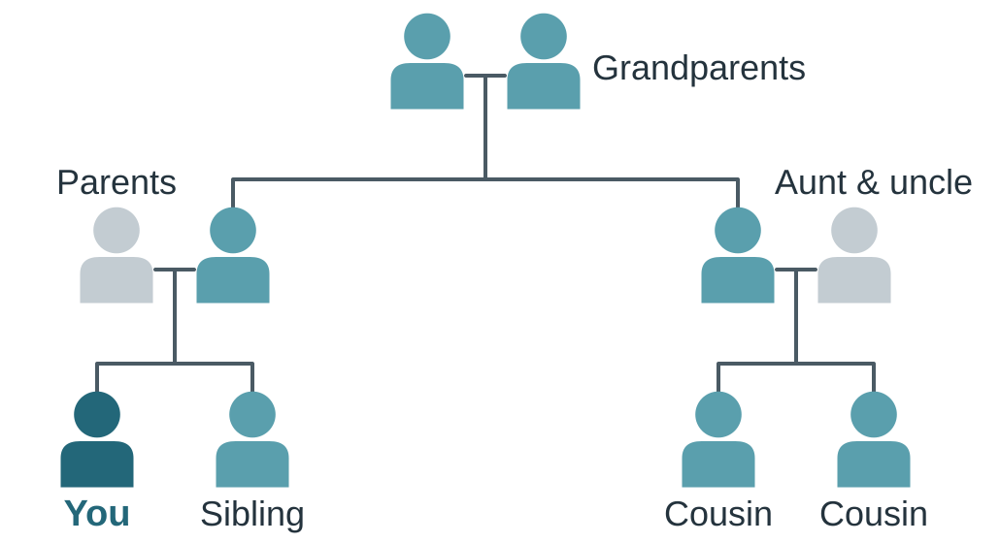
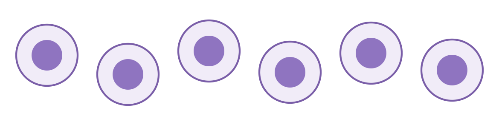
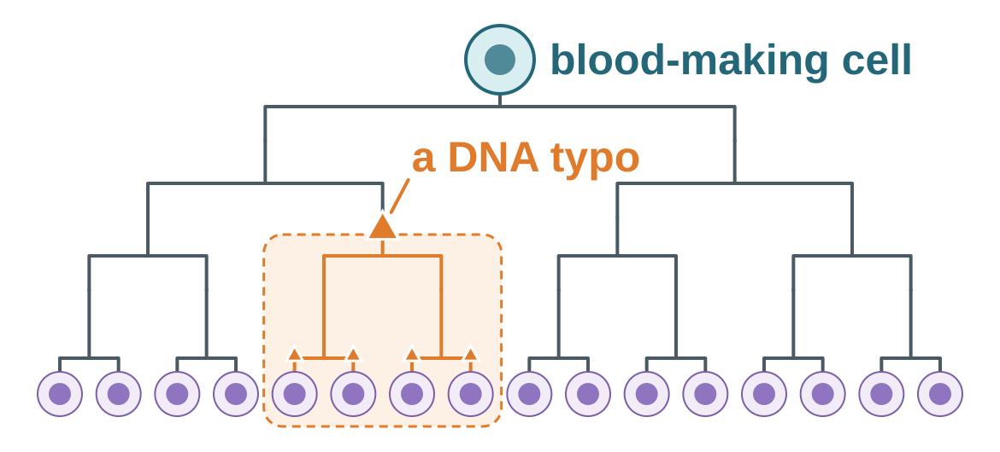
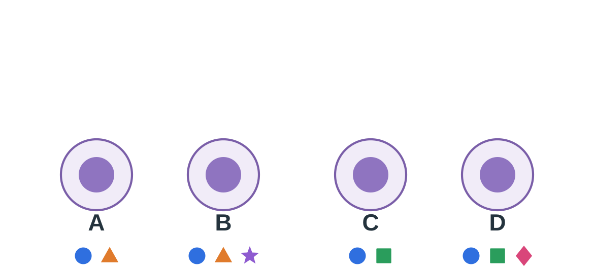
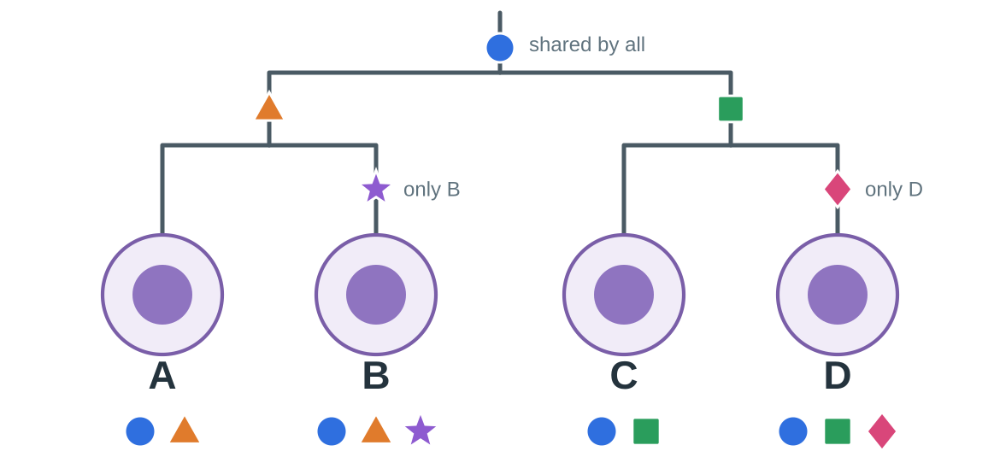
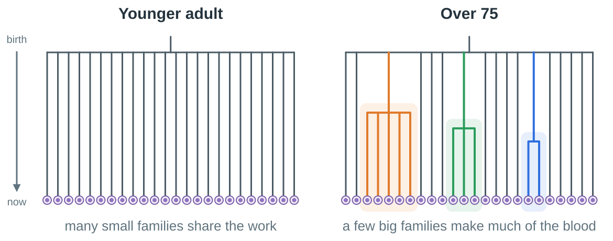
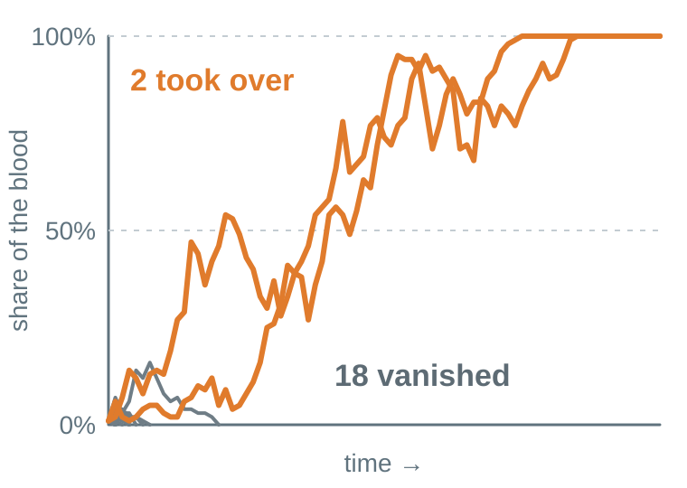
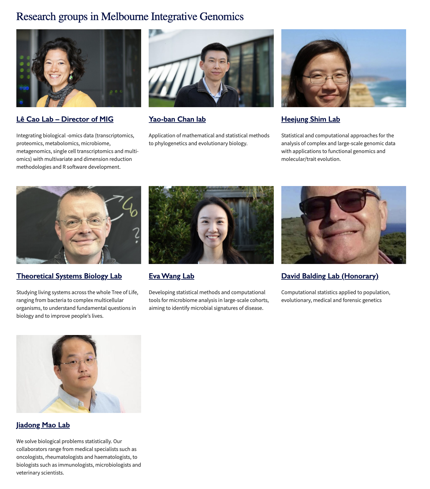

## Who is your closest relative?

::: {.columns}
::: {.column width="62%"}
{width="100%" fig-alt="A human family tree: grandparents at the top, then your parents and your aunt and uncle, then you, your sibling and two cousins."}
:::

::: {.column width="35%"}

Your sibling or your cousin?

::: {.fragment}
Closer relatives share a **more recent** ancestor.
:::

::: {.fragment .takeaway}
People keep names, photos and memories. But what about cells?
:::
:::
:::

::: {.source}
Simplified family tree
:::

::: {.notes}
[0:00–1:00]

I want to start with something you already know: a family tree. Here are your grandparents, your parents, your aunt and uncle, and you, your sibling and your cousins.

Quick question: who is your closer relative, your sibling or your cousin? [Pause.]

[Click.] Your sibling. You share the same parents, but your cousin only shares your grandparents. Closer relatives share a more recent ancestor. Keep that idea in mind; it is the key to the whole talk.

[Click.] For people, drawing this tree is easy: we have names, photos, birth certificates, and Grandma's memory. But your body is full of cells that have family trees too, and nobody kept any records.

(One difference, if asked: a cell has just one parent, because it was made by one cell splitting in two.)
:::

## Your blood also has a family tree

{width="100%" fig-alt="Six white blood cells that look almost identical."}

- White blood cells: fighting invading bacteria and viruses
- Every one of these cells came from another cell
- Just like people, they have a family tree

::: {.center .big}
Which ones are **close relatives**?
:::

::: {.notes}
[1:00–1:40]

Now look at these. They are white blood cells, the cells that fight infection. You have billions of them, and they look almost the same.

But every one of them came from another cell that split in two. So, just like people, your cells have a family tree. Some are close cousins; some are very distant relatives.

The catch: nobody was watching when they divided. Can we still work out the family tree? That is the puzzle I want to solve with you today.
:::

## From one cell to a whole family

{width="50%" fig-alt="A family tree: one blood-making cell at the top divides repeatedly into sixteen white blood cells. A DNA typo on one branch is inherited by the four cells below it, which form one cell family."}

- When cells divide to produce children, they create two copies of everything
- Including DNA – blue maps for making things cells need
- But cells make mistakes when copying

::: {.takeaway}
A DNA typo is copied into **every descendant**: a clue to who is related.
:::

::: {.notes}
[1:40–2:40]

Deep in your bones, in the bone marrow, live blood-making cells. Scientists call them stem cells. Each can divide again and again, and its descendants end up in your blood.

Every cell carries DNA, the cell's instruction book, billions of letters long. Each time a cell divides it copies the whole book, and now and then it makes a tiny typo. Most typos do nothing at all.

But here is the useful part. Once a typo appears, it is copied into every descendant of that cell. So all four cells under this orange mark carry it.

All the cells that came from one ancestor form a *cell family*. Biologists call it a clone. A cell family is not a disease; it is just a branch of the tree. And the typos work like a surname handed down a family.

(Teachers: the "typos" are naturally occurring somatic mutations.)
:::

## Puzzle: who are the closest relatives?

::: {.r-stack}
{width="86%" fig-alt="Four white blood cells A to D. A: circle, triangle. B: circle, triangle, star. C: circle, square. D: circle, square, diamond."}

::: {.fragment}
{width="86%" fig-alt="The answer: A and B are siblings, C and D are siblings. The circle sits on the root, the triangle on the A–B branch, the square on the C–D branch, the star only on B and the diamond only on D."}
:::
:::

::: {.fragment .takeaway .center}
Shared typos reveal relatives.
:::

::: {.notes}
[2:40–4:05]

Here are four white blood cells, A, B, C and D. Under each one are the DNA typos we found when we read its DNA; each shape is a different typo.

Which two cells are the closest relatives? Take 20 seconds and talk to your neighbour.

[Pause ~20 s.]

Who said A and B? C and D? Anyone say B and D, because they both have an extra mark? That is the trap!

[Click.] The blue circle is in everyone, so it happened in a very early ancestor. The orange triangle is shared by A and B, so it happened in *their* shared ancestor; the green square, likewise, for C and D. The star is only in B, so it happened after B's branch split off.

[Click.] So shared marks reveal relatives. A private mark tells us that cell kept dividing on its own, but nothing about who it is related to.
:::

## What do we care about family trees?

{width="94%" fig-alt="Two family trees of 24 white blood cells, drawn from birth at the top to now at the bottom. Younger adult: every cell sits on its own branch, so many small families share the work. Over 75: three coloured families of five, three and two cells branch off partway down, so a few big families make much of the blood."}

::: {.takeaway .center}
With age, a few families make a **much bigger share** of the blood. Why?
:::

::: {.source}
Simplified illustration based on [Mitchell et al., *Nature* 2022](https://www.nature.com/articles/s41586-022-04786-y)
:::

::: {.notes}
[4:55–5:45]

So why draw the tree at all? Because its shape shows how your body makes blood.

When scientists drew real trees, younger adults had bushy ones [point left]: 20,000 to 200,000 blood-making cells, all sharing the work evenly.

In people over 75 [point right], just 12 to 18 families made 30 to 60 per cent of the blood.

Most DNA typos are harmless clues, like a surname. But a few might change how a cell behaves, and one open question is whether such typos help some families take a bigger share.

So why did a few families get so big? We will come back to that with a game.

(Source detail, Mitchell et al. 2022 abstract: adults under 65 had a stable population of 20,000–200,000 stem and multipotent progenitor cells contributing evenly; in each subject over 75, 12–18 independent clones accounted for 30–60% of haematopoiesis; most expanded clones had begun expanding before age 40 (a fact the tree's branch points reveal), and only 22% carried known driver mutations. The 24-cell trees are invented for illustration.)
:::

## 

::: {.cards}
::: {.card}

Growing older

Why does blood change with age?

:::

::: {.card .mine}

Recovering

How does blood **rebuild itself** after a blood transplant?

:::

::: {.card}

Cancer risk

Which families are **linked** to blood cancer?
:::
:::

::: {.takeaway .center}
Maths and stats turns clues into explanations we can test.
:::

::: {.source}
1 in 10 and cancer link: [Jaiswal et al., *New England Journal of Medicine* 2014](https://pubmed.ncbi.nlm.nih.gov/25426837/)
:::

::: {.notes}
[7:50–9:00]

Why does this matter?

Growing older: in people in their seventies, about one in ten has a cell family large enough to spot with standard DNA tests. Understanding why tells us how our bodies age.

Recovering: in a bone marrow transplant, a small number of donated blood-making cells must rebuild an entire blood system. In my own research I ask how those cell families grow and share the work as the blood rebuilds. It is still an open question.

Risk: across large groups of people, having a large cell family is linked to a higher chance of blood cancer later on. That is a pattern across many people, not a forecast for any one person.

So whether it is a competition problem or a mystery in your blood, the skills are the same: collect the clues, propose an explanation, test it, and be honest about what the clues cannot tell you.

(Source detail: Jaiswal et al. 2014 found detectable mutations in 9.5% of people aged 70–79, 11.7% aged 80–89 and 18.4% aged 90–108; they were associated with higher risk of blood cancer, hazard ratio 11.1.)
:::

## An evolutionary game

::: {.columns}
::: {.column width="40%"}
::: {.rules}
**Rules**

1. Suppose can only maintain 100 blood cells – limited space and resource.
1. When one cell dies, another new one fills in.
1. Different families competing.
1. Cells with a helpful typo (lucky cells) can divide a bit more often – say 10% more often than others.
:::
:::

::: {.column width="57%"}
::: {.r-stack}
::: {.fragment .fade-out fragment-index="1"}

One cell gets a helpful typo.

Will its family take over? (20 simulations)

:::

::: {.fragment fragment-index="1"}
{width="90%" fig-alt="Twenty computer runs of the game. Each line is the share of the blood made by the family with the helpful typo. Eighteen lines drop to zero early; two rise to 100%."}
:::
:::
:::
:::

::: {.fragment .takeaway .center}
A small advantage may make you hugely successful family, but not always (that's life – keep trying!).
:::

::: {.notes}
[5:45–6:45]

So why did a few families get so big? Let's play a game. Mathematicians call games like this evolutionary games.

Imagine 100 blood-making cells. Each turn, one cell is lost, and a copy of another cell takes its place. Most cells are equal. But one cell has a helpful typo, so it gets copied a bit more often: 11 times for every 10. That edge is what biologists call fitness.

Will the family with the helpful typo take over? Hands up for yes. [Pause.]

[Click.] Here are 20 computer runs of this game. In 18 of them the family vanished! It starts as just one cell, and one unlucky turn wipes it out. Only 2 took over. The maths says the chance is about 1 in 11.

[Click.] So luck decides who gets started. But once a family survives its risky start, its small edge, repeated for decades, makes it huge. When scientists played this kind of game over a whole human lifetime, with helpful typos turning up now and then, it explained the big families in older people's blood.

(Teachers: this is a Moran process with N = 100 and relative fitness r = 1.1. The chance of taking over is (1 − 1/r)/(1 − 1/r^N), about 1 − 1/r ≈ 9%. The random seed was chosen to show 2 takeovers in 20 runs, close to the expected 1.8. In real blood a family rarely takes over everything: many families compete and new typos keep arriving. Mitchell et al. 2022 report that simulations with a constant stem-cell population and a steady supply of moderately helpful typos fully explained the change seen in older people. A bigger share alone does not prove a family is fitter; luck alone can also make a family big.)
:::

## Who to talk to: MIG people

::: {.columns}
::: {.column width="50%"}
{width="100%"}
:::

::: {.column width="50%"}
- Melbourne Integrative Genomics (MIG)
- We solve different kinds of maths and stats problems in biology
- We work on big data from biology 
- We also work on bacteria (in gut, in soil), forensic statistics (bad guys leave traces too), even quantum computing
:::
:::

## {background-color="#eef3f5"}

::: {.center style="margin-top: 200px;"}

Congratulations!

to all of this year's prize winners

:::

::: {.notes}
Stays up during the prize presentation.

Congratulations to everyone here today. I can't wait to see which mysteries you solve next. It is now my pleasure to present the prizes for [division].
:::
